# Classification Algorithms — Decision Trees, k-NN and KDE Naive Bayes

> University project · *Introduction to Machine Learning* (ELEN0062, University of Liège) · Project 1 · Python

This project studies how three classification algorithms behave on 2D synthetic datasets, and how their main hyper-parameter controls the trade-off between **underfitting** and **overfitting**:

| Algorithm | Hyper-parameter | Implementation |
|---|---|---|
| Decision tree | maximum depth | scikit-learn |
| k-nearest neighbours | number of neighbours *k* | scikit-learn |
| Naive Bayes with kernel density estimation | bandwidth *h* | **implemented from scratch**, as a scikit-learn compatible estimator |

## Datasets

- **Two moons** (`make_dataset`): two interleaved, noisy and rotated half-circles. The classes are not linearly separable.
- **XOR** (`make_xor_dataset`): uniform points in [-2, 2]², class 1 when the two coordinates have different signs. Each feature taken alone carries no information about the class, which breaks the independence assumption of Naive Bayes.

Each experiment uses 1,500 points: 1,200 for learning and 300 for testing, repeated over 5 random generations of the dataset.

## Results

### Effect of the hyper-parameter (two moons)

| Decision tree depth | 1 | 3 | 6 | 12 | unbounded |
|---|---|---|---|---|---|
| Test accuracy | 0.735 | 0.888 | **0.954** | 0.947 | 0.946 |

| k-NN, *k* | 1 | 9 | 45 | 225 | 901 |
|---|---|---|---|---|---|
| Test accuracy | 0.945 | **0.960** | 0.959 | 0.953 | 0.637 |

| Naive Bayes bandwidth *h* | 0.005 | 0.03 | 0.2 | 0.8 | 3.2 |
|---|---|---|---|---|---|
| Test accuracy | 0.843 | 0.905 | **0.937** | 0.772 | 0.661 |

Small depths, large *k* and large bandwidths **underfit**: the decision boundary is too simple. Unbounded depths, *k* = 1 and very small bandwidths **overfit**: the boundary follows the noise of the learning set.

**Decision trees**

| Depth 1 (underfit) | Depth 6 | Unbounded depth (overfit) |
|---|---|---|
| 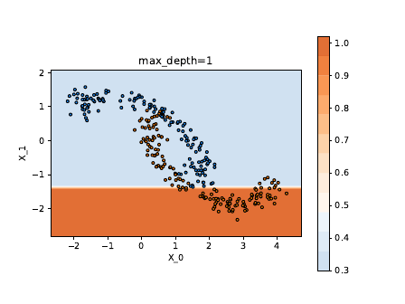 | 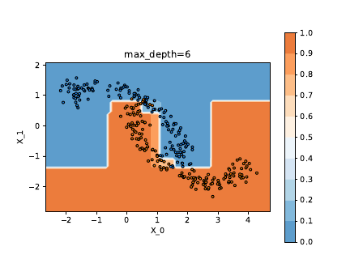 | 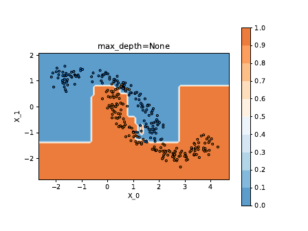 |

**k-NN**

| *k* = 1 (overfit) | *k* = 45 | *k* = 901 (underfit) |
|---|---|---|
| 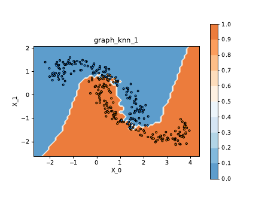 |  | 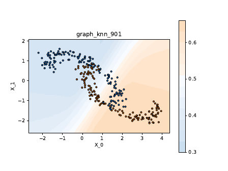 |

**KDE Naive Bayes**

| *h* = 0.005 (overfit) | *h* = 0.2 | *h* = 3.2 (underfit) |
|---|---|---|
| 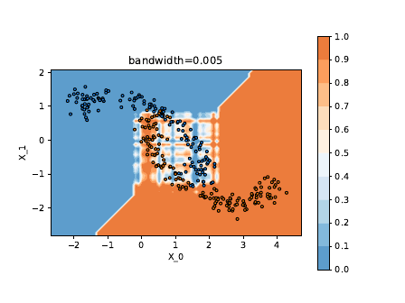 | 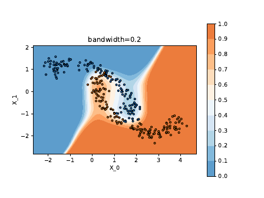 | 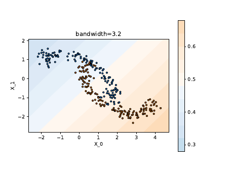 |

### Model comparison

The hyper-parameter of each model is selected with **5-fold cross-validation** on the learning set. The tuned model is then evaluated on the test set over 5 generations of the dataset.

| Model | Two moons | XOR |
|---|---|---|
| Decision tree | **0.961** ± 0.013 (depth 6) | **0.997** ± 0.003 (depth 12) |
| k-NN | 0.959 ± 0.005 (*k* = 45) | 0.985 ± 0.006 (*k* = 1) |
| KDE Naive Bayes | 0.943 ± 0.007 (*h* = 0.2) | 0.509 ± 0.017 (*h* = 0.03) |

On XOR, Naive Bayes is no better than random guessing. It models each feature independently, while the class only depends on the *combination* of the two features. Decision trees and k-NN do not make this assumption.

| | Decision tree | k-NN | KDE Naive Bayes |
|---|---|---|---|# Classification Algorithms — Decision Trees, k-NN and KDE Naive Bayes

> University project · *Introduction to Machine Learning* (ELEN0062, University of Liège) · Project 1 · Python

This project studies how three classification algorithms behave on 2D synthetic datasets, and how their main hyper-parameter controls the trade-off between **underfitting** and **overfitting**:

| Algorithm | Hyper-parameter | Implementation |
|---|---|---|
| Decision tree | maximum depth | scikit-learn |
| k-nearest neighbours | number of neighbours *k* | scikit-learn |
| Naive Bayes with kernel density estimation | bandwidth *h* | **implemented from scratch**, as a scikit-learn compatible estimator |

## Datasets

- **Two moons** (`make_dataset`): two interleaved, noisy and rotated half-circles. The classes are not linearly separable.
- **XOR** (`make_xor_dataset`): uniform points in [-2, 2]², class 1 when the two coordinates have different signs. Each feature taken alone carries no information about the class, which breaks the independence assumption of Naive Bayes.

Each experiment uses 1,500 points: 1,200 for learning and 300 for testing, repeated over 5 random generations of the dataset.

## Results

### Effect of the hyper-parameter (two moons)

| Decision tree depth | 1 | 3 | 6 | 12 | unbounded |
|---|---|---|---|---|---|
| Test accuracy | 0.735 | 0.888 | **0.954** | 0.947 | 0.946 |

| k-NN, *k* | 1 | 9 | 45 | 225 | 901 |
|---|---|---|---|---|---|
| Test accuracy | 0.945 | **0.960** | 0.959 | 0.953 | 0.637 |

| Naive Bayes bandwidth *h* | 0.005 | 0.03 | 0.2 | 0.8 | 3.2 |
|---|---|---|---|---|---|
| Test accuracy | 0.843 | 0.905 | **0.937** | 0.772 | 0.661 |

Small depths, large *k* and large bandwidths **underfit**: the decision boundary is too simple. Unbounded depths, *k* = 1 and very small bandwidths **overfit**: the boundary follows the noise of the learning set.

**Decision trees**

| Depth 1 (underfit) | Depth 6 | Unbounded depth (overfit) |
|---|---|---|
|  |  |  |

**k-NN**

| *k* = 1 (overfit) | *k* = 45 | *k* = 901 (underfit) |
|---|---|---|
|  |  |  |

**KDE Naive Bayes**

| *h* = 0.005 (overfit) | *h* = 0.2 | *h* = 3.2 (underfit) |
|---|---|---|
|  |  |  |

### Model comparison

The hyper-parameter of each model is selected with **5-fold cross-validation** on the learning set. The tuned model is then evaluated on the test set over 5 generations of the dataset.

| Model | Two moons | XOR |
|---|---|---|
| Decision tree | **0.961** ± 0.013 (depth 6) | **0.997** ± 0.003 (depth 12) |
| k-NN | 0.959 ± 0.005 (*k* = 45) | 0.985 ± 0.006 (*k* = 1) |
| KDE Naive Bayes | 0.943 ± 0.007 (*h* = 0.2) | 0.509 ± 0.017 (*h* = 0.03) |

On XOR, Naive Bayes is no better than random guessing. It models each feature independently, while the class only depends on the *combination* of the two features. Decision trees and k-NN do not make this assumption.

**Two moons**

| Decision tree | k-NN | KDE Naive Bayes |
|---|---|---|
| 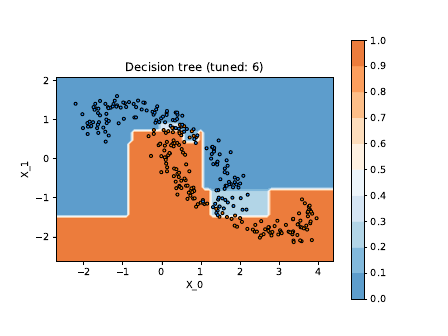 | 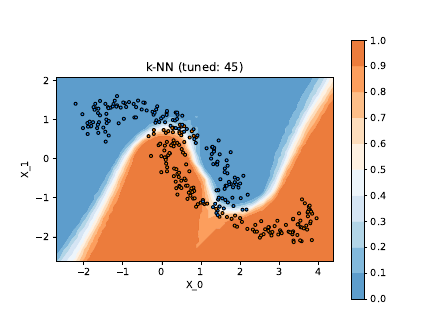 | 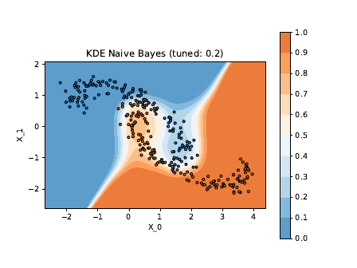 |

**XOR**

| Decision tree | k-NN | KDE Naive Bayes |
|---|---|---|
| 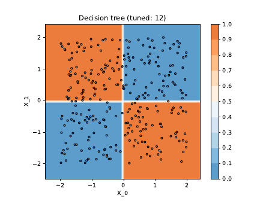 | 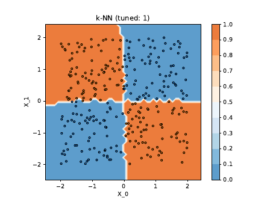 | 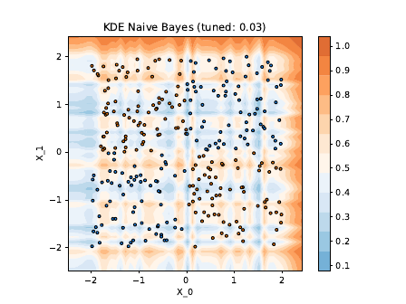 |

## Repository structure

```
.
├── data.py      # Dataset generators (two moons, XOR)
├── plot.py      # Decision boundary plotting
├── dt.py        # Decision tree experiments
├── knn.py       # k-NN experiments
├── nb.py        # KDE Naive Bayes classifier and experiments
├── mc.py        # Model comparison with 5-fold cross-validation
└── decision_tree_results/, knn_result/, naive_bayes_results/, model_comparison/
                 # Generated decision boundaries (PDF, with a PNG copy for this README)
```

`data.py` and `plot.py` were provided by the course.

## Running

```bash
pip install numpy scikit-learn matplotlib
python dt.py     # decision trees
python knn.py    # k-NN
python nb.py     # Naive Bayes
python mc.py     # model comparison
```

Each script prints the accuracies and saves the decision boundary plots as PDF files.
| **Two moons** |  |  |  |
| **XOR** |  |  |  |

## Repository structure

```
.
├── data.py      # Dataset generators (two moons, XOR)
├── plot.py      # Decision boundary plotting
├── dt.py        # Decision tree experiments
├── knn.py       # k-NN experiments
├── nb.py        # KDE Naive Bayes classifier and experiments
├── mc.py        # Model comparison with 5-fold cross-validation
└── decision_tree_results/, knn_result/, naive_bayes_results/, model_comparison/
                 # Generated decision boundaries (PDF, with a PNG copy for this README)
```

`data.py` and `plot.py` were provided by the course.

## Running

```bash
pip install numpy scikit-learn matplotlib
python dt.py     # decision trees
python knn.py    # k-NN
python nb.py     # Naive Bayes
python mc.py     # model comparison
```

Each script prints the accuracies and saves the decision boundary plots as PDF files.
